[LinkedIn](https://www.linkedin.com/in/aizhan-amanova-25916b253/) · [Email](mailto:amanovaintech@gmail.com)

---

## 📍 Currently

- Final-year Mechatronics Engineering student at Óbuda University, Budapest
- **Thesis:** comparing machine learning models for predicting bearing remaining useful life (RUL) from vibration data
- **Research:** predicting driving performance under 50 hours of sleep deprivation with neural networks
- **Open to:** software development and industrial automation internships and graduate roles

---

## 🛠 Featured Projects

### 1. Bearing Health Assessment & RUL Prediction

*Predicting how long an industrial bearing has left before it fails, from vibration data.*

- **Problem:** Unplanned bearing failures stop production lines; maintenance teams need to know *when* a bearing will fail, not just *that* it is degrading.
- **Approach:** Time-domain feature extraction and health indicators on the NASA IMS run-to-failure dataset, degradation-onset detection, then a comparison of Linear Regression, Random Forest and SVR under a leakage-free leave-one-bearing-out protocol.
- **Result:** In progress — model comparison and sensitivity analysis due December 2026.

**Stack:** `Python` `Pandas` `NumPy` `Scikit-learn`
[Code →](https://github.com/Aizhanaaah/IMS_Bearing_Degradation_Prediction_System)

---

### 2. Sleep Deprivation & Driving Performance

*Predicting driving performance of drivers kept awake for 50 hours.*

- **Problem:** Sleep loss is a major cause of road accidents, but its effect on driving is hard to quantify before it becomes dangerous.
- **Approach:** Neural network models trained on driving-simulator sensor data (speed, velocity) collected during 50 hours of total sleep deprivation.
- **Result:** In progress.

**Stack:** `Python` `Pandas` `Neural Networks`
[Code →](https://github.com/Aizhanaaah/DrivingPerformancePredictionFromSleepData)

---

### 3. Finance Tracker

*Full-stack web app for tracking personal income and expenses.*

- **Problem:** Build a realistic multi-user backend with authentication, a relational data model and business rules — not just CRUD.
- **Approach:** Layered Spring MVC architecture (controller → service → repository) with DTO-based validation, Spring Security (BCrypt, form login) and per-user data isolation enforced in every query.
- **Result:** Users manage income/expense categories and transactions, filter by type, category and date range, and see monthly and all-time balances on a dashboard powered by JPQL aggregate queries.

**Stack:** `Java 21` `Spring Boot` `Spring Security` `Spring Data JPA` `MySQL` `Thymeleaf`
[Code →](https://github.com/Aizhanaaah/FinancialTracker)

---

### 4. Flight Activity Analysis Dashboard

*Interactive dashboard for exploring flight patterns on maps and charts.*

- **Problem:** Raw flight data is impossible to read at a glance.
- **Approach:** Cleaned the dataset, then built filters, maps and charts to explore it interactively.
- **Result:** An interactive dashboard for exploring flight activity by route, time and region.

**Stack:** `Python` `Pandas` `Data Visualization`
[Code →](https://github.com/Aizhanaaah/Flight_Data_Analysis)

---

## ⚙️ Toolkit

| | |
|---|---|
| **Languages** |    |
| **Backend** |   |
| **Data / ML** |    |
| **Tools** |    |
| **Domain** | Mechatronics, industrial automation (FANUC robotics, machine vision), predictive maintenance, backend development |
